

  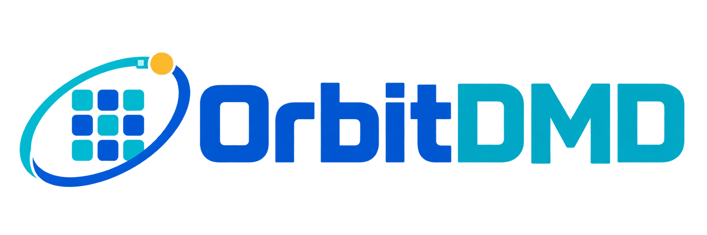

<a href="README.md">Français</a> · <a href="README.en.md">English</a> · <a href="README.nl.md">Nederlands</a> · <a href="README.es.md">Español</a> · <a href="README.ru.md">Русский</a> · <b>Deutsch</b> · <a href="README.it.md">Italiano</a> · <a href="README.pt.md">Português</a> · <a href="README.pl.md">Polski</a> · <a href="README.uk.md">Українська</a> · <a href="README.tr.md">Türkçe</a> · <a href="README.cs.md">Čeština</a>

  <b>Ihre HUB75-LED-Panels am Raspberry Pi 3: animierte GIFs, Uhr und Wetter, eingestellt im Browser.</b> 
  Ohne Linux, startet in wenigen Sekunden. Installation in 5 Schritten unter Windows.

  
  
  
  

---

## Was OrbitDMD macht

OrbitDMD verwandelt einen **Raspberry Pi 3** und **HUB75-LED-Panels** (zum Beispiel 2 × 64×32) in eine
„DMD“-Anzeige wie bei Flipper- oder Arcade-Automaten:

- 🎞️ **animierte GIFs** nach Kategorien (562 mitgeliefert), über die Webseite einzeln, als ganzer Ordner
  oder als .zip hinzufügbar; Lieblings-GIFs und GIFs außerhalb der Rotation;
- 🕒 **Uhr**: 14 Schriften, Farben, animierter Regenbogen, Muster, 13 animierte Hintergründe, Zufallsauswahl,
  Datum, Zeitabgleich über das Internet;
- 💬 **Nachrichten**: Lauftexte und Countdowns (Weihnachten, Neujahr, beliebiges Datum), jeweils mit eigenem
  Stil und Einstiegseffekt (Laufen, Steigen, Buchstabe für Buchstabe, Buchstabenregen, Einblenden…);
- 🏠 **Home Assistant**: das Panel erscheint dort von selbst (MQTT); Ein/Aus, Helligkeit und Nachrichten aus
  Ihren Automatisierungen ([Anleitung](docs/HOME-ASSISTANT.de.md));
- 🗓️ **Zeitplan**: Panel nachts aus oder zu bestimmten Stunden nur die Uhrzeit, GIF-Kategorien nach Monaten
  (Weihnachten im Dezember…), Texte und Countdowns nur zwischen zwei Daten aktiv;
- 📐 **zu große GIFs werden beim Hochladen automatisch** auf das Panelformat verkleinert;
- ⛅ **Wetter** Ihres Ortes (Open-Meteo, ohne Anmeldung) mit animierten Symbolen;
- 🌐 **Webseite** im Heimnetz (`http://orbitdmd.local/`): Live-Vorschau des Panels, Einstellungen, Helligkeit
  nach Uhrzeit, Pause, Ausschalten, Sicherung der Einstellungen, Updates;
- 🌍 **12 Sprachen** für Webseite, Installation, Panel-Texte und Home Assistant (Deutsch inklusive);
- ⚡ **ohne Linux**: das Programm startet direkt auf dem Raspberry Pi (auf Basis von
  [Circle](https://github.com/rsta2/circle)), in wenigen Sekunden.

  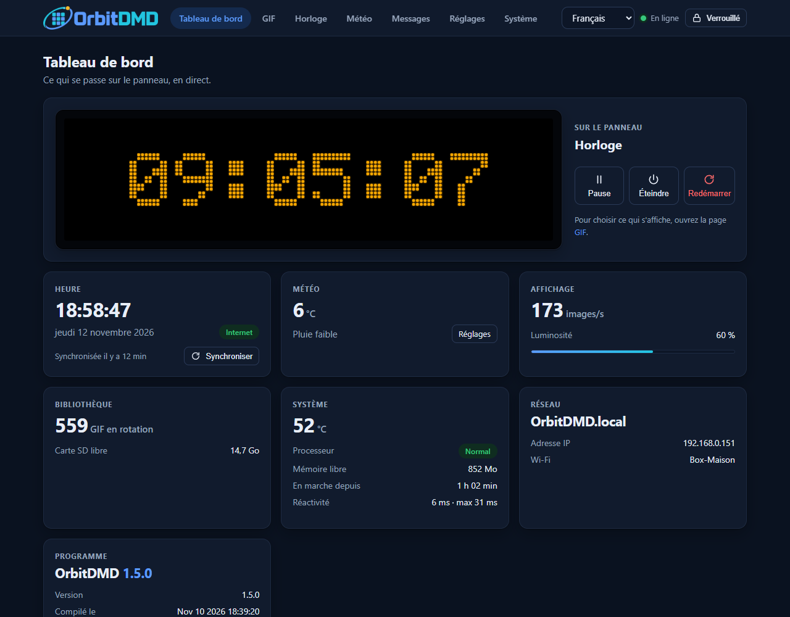
  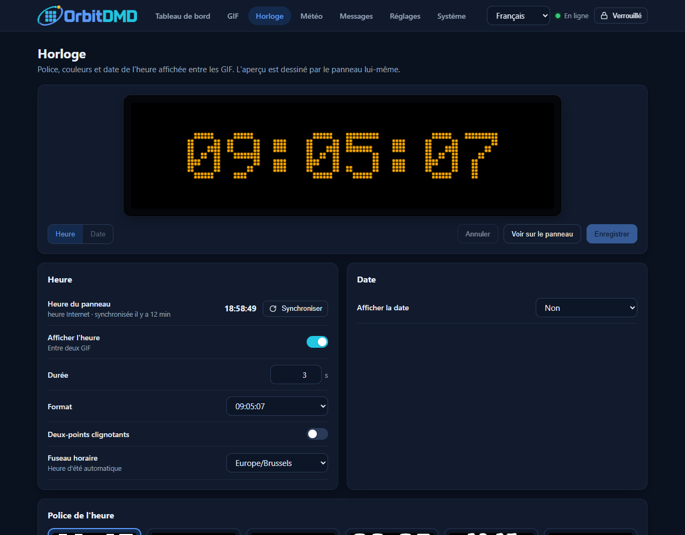

  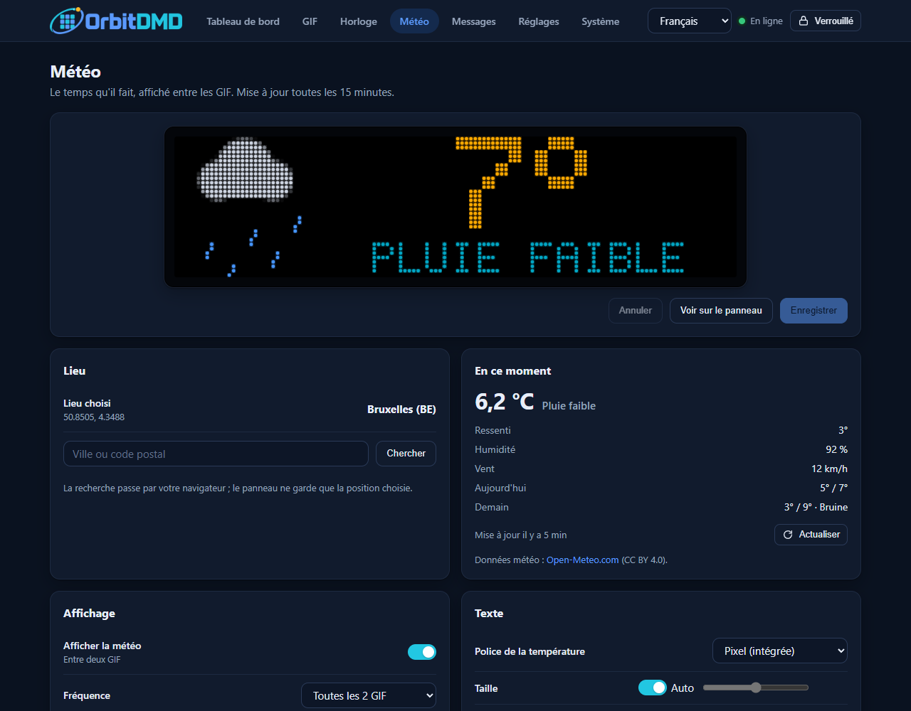
  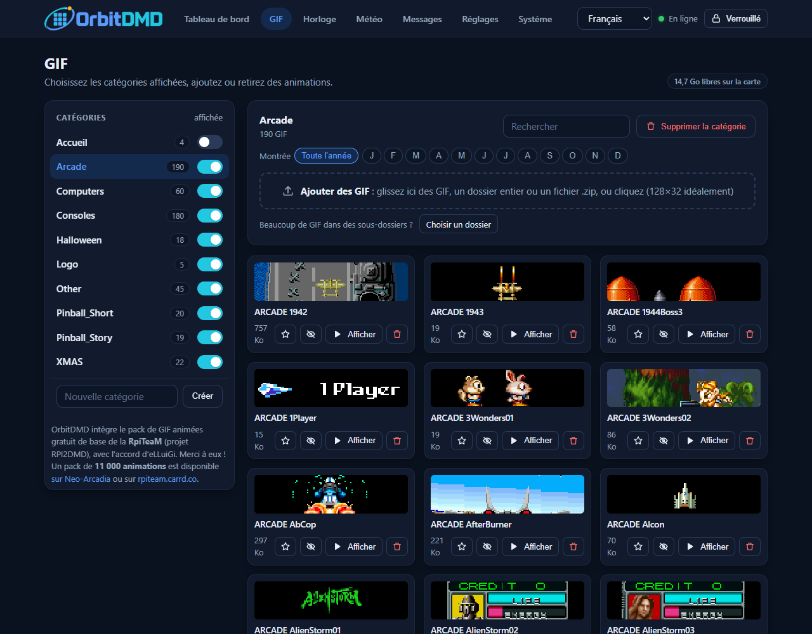

  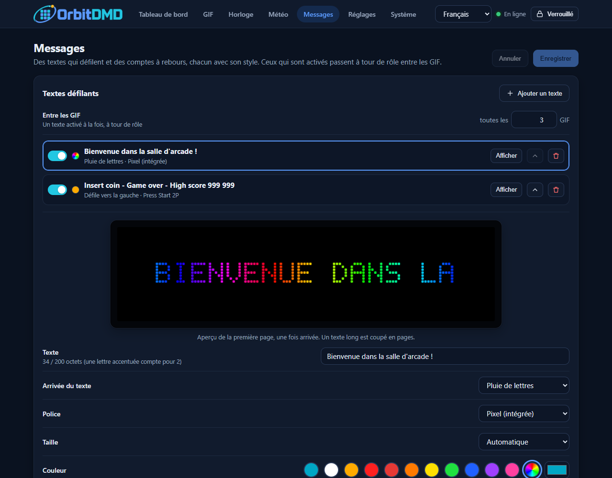
  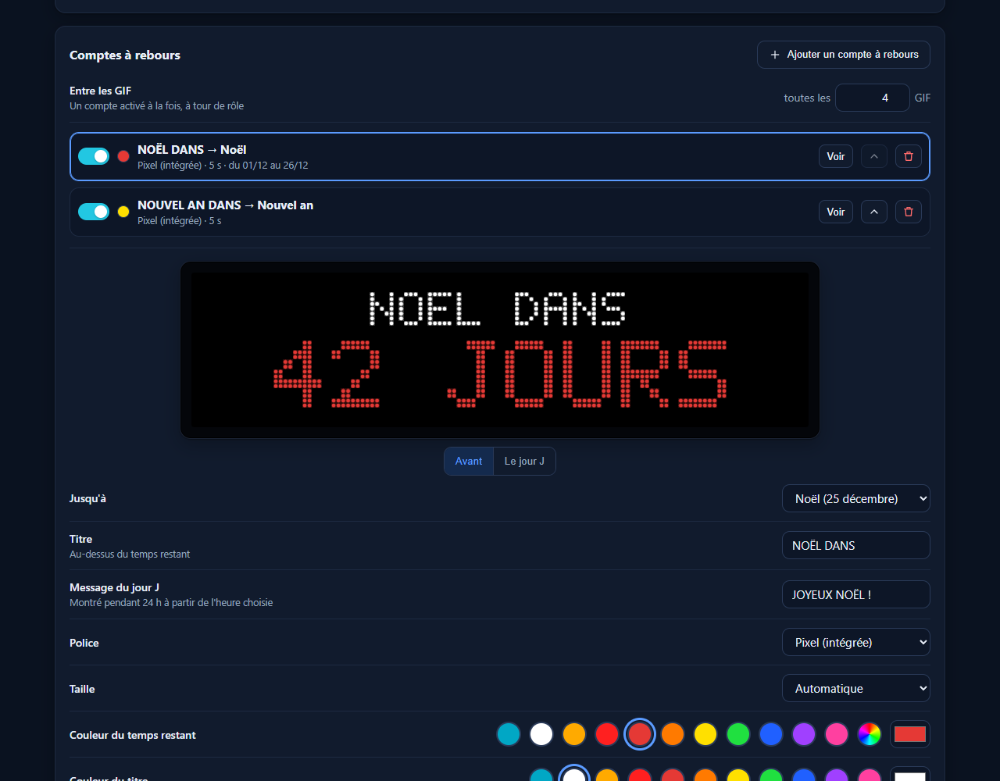

  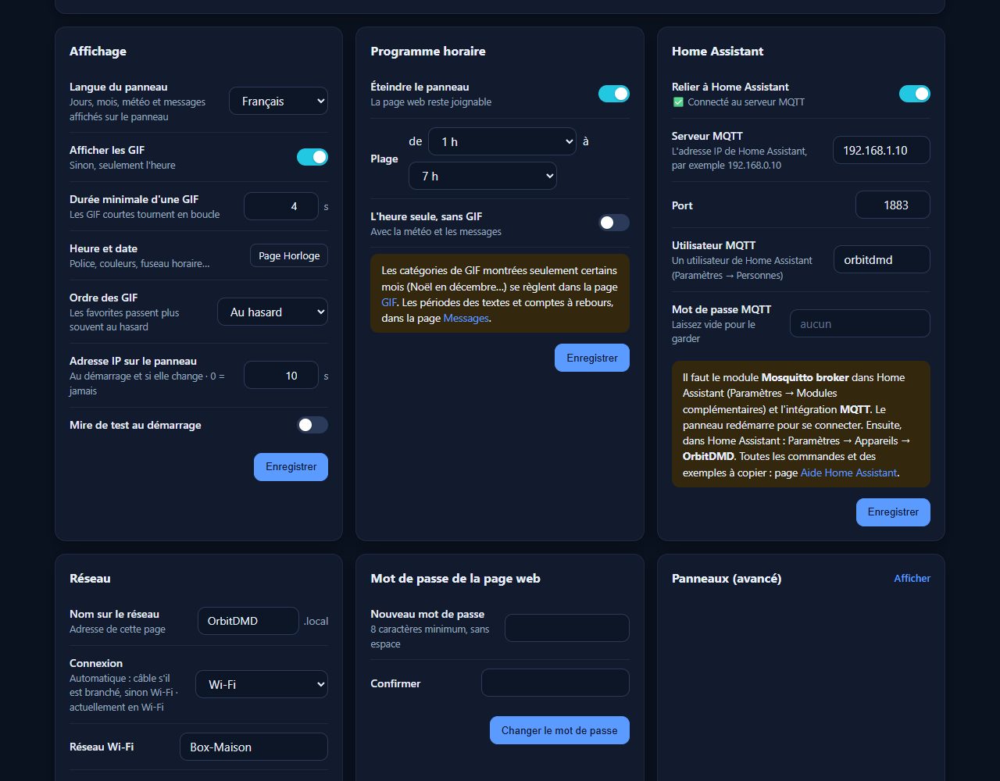
  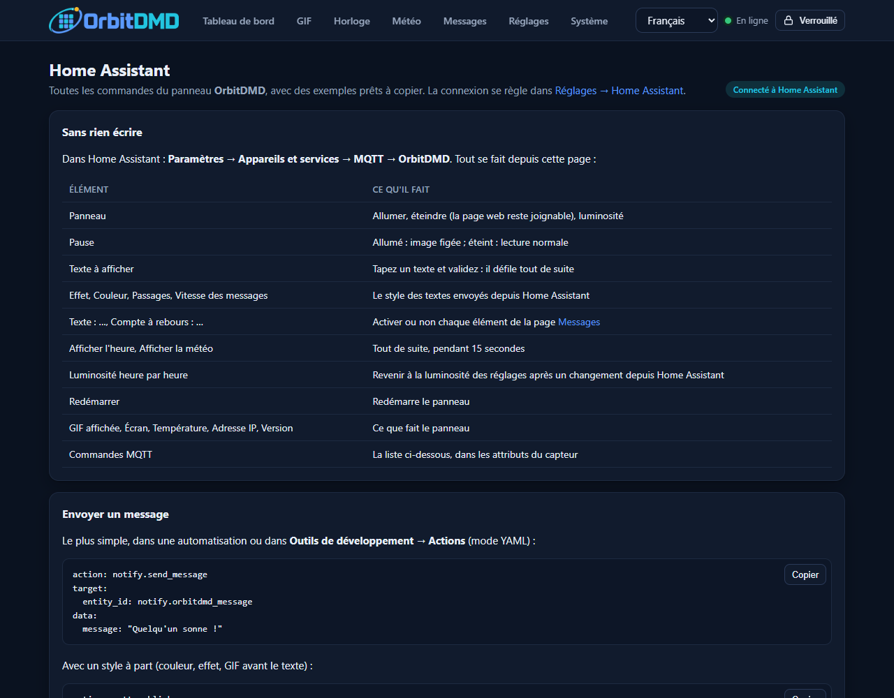

## Hardware

| Teil | Details |
|---|---|
| Raspberry Pi | **Raspberry Pi 3** (Modell B oder B+) mit Netzteil |
| Panels | HUB75, standardmäßig 2 × 64×32 nebeneinander (128×32); 64×64, 32×16 und bis zu 8 Panels möglich |
| Adapterplatine | HUB75 für Raspberry Pi, Belegung **„regular“** von rpi-rgb-led-matrix (z. B. Electrodragon); die Adafruit-HAT-Belegung wird nicht unterstützt |
| Stromversorgung der Panels | 5 V, ausreichend für Ihre Panels (etwa 4 A pro 64×32-Panel bei voller Helligkeit) |
| micro-SD-Karte | 32 GB oder weniger empfohlen (es wird eine FAT32-Partition von höchstens 31 GB erstellt) |
| Netzwerk | Netzwerkkabel (Ethernet) oder WLAN 2,4 GHz (der Raspberry Pi 3 sieht kein 5 GHz) |

## Installation

1. **Laden Sie** `OrbitDMD-Installateur-<Version>.exe` von der Seite
   [Releases](https://github.com/ulrikadam/OrbitDMD/releases/latest) herunter (Windows 10 oder 11, sonst nichts zu installieren).
2. **Starten Sie es.** Das Programm ist nicht signiert: zeigt Windows „Der Computer wurde durch Windows geschützt“,
   klicken Sie auf *Weitere Informationen* und dann *Trotzdem ausführen*. Die Installation spricht die Sprache von
   Windows (wählbar auf der ersten Seite).
3. **Beantworten Sie die Fragen**: Name des Panels, Anordnung der Panels, WLAN, Passwort der Webseite, Zeitzone,
   Ort für das Wetter, zu installierende GIFs.
4. **Wählen Sie die micro-SD-Karte**. Es werden nur Kartenleser und USB-Sticks angeboten, nie interne
   Festplatten; der gesamte Inhalt der gewählten Karte wird gelöscht.
5. **Stecken Sie die Karte in den Raspberry Pi** und schalten Sie ihn ein. Öffnen Sie nach etwa dreißig Sekunden
   `http://<Name des Panels>.local/` (oder die IP-Adresse, die Ihr Router vergeben hat).

  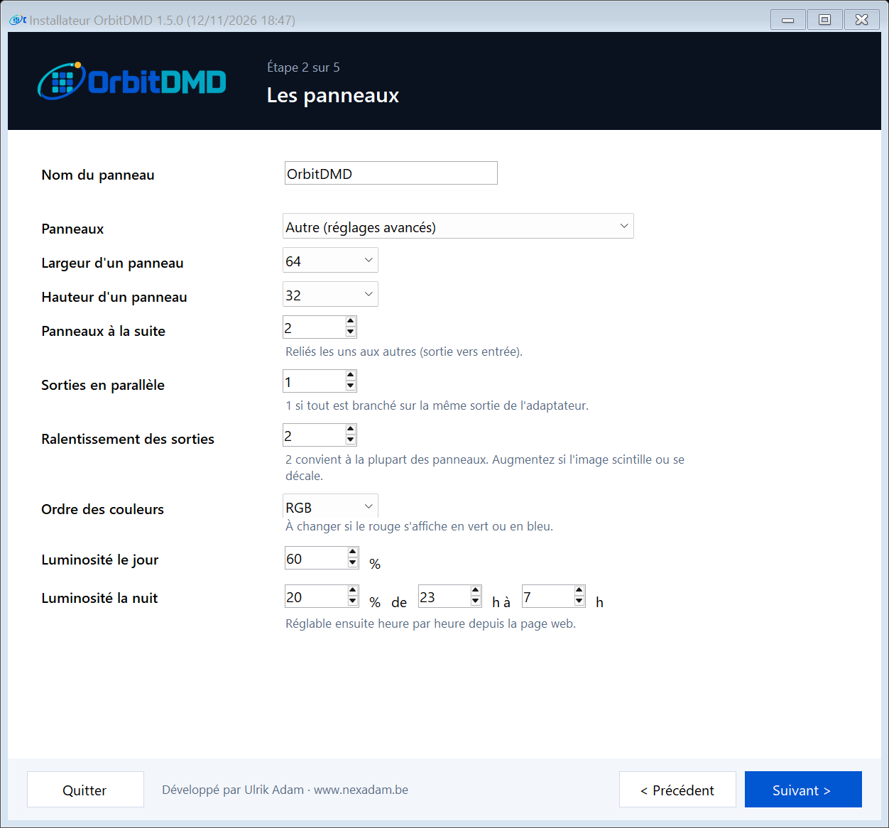
  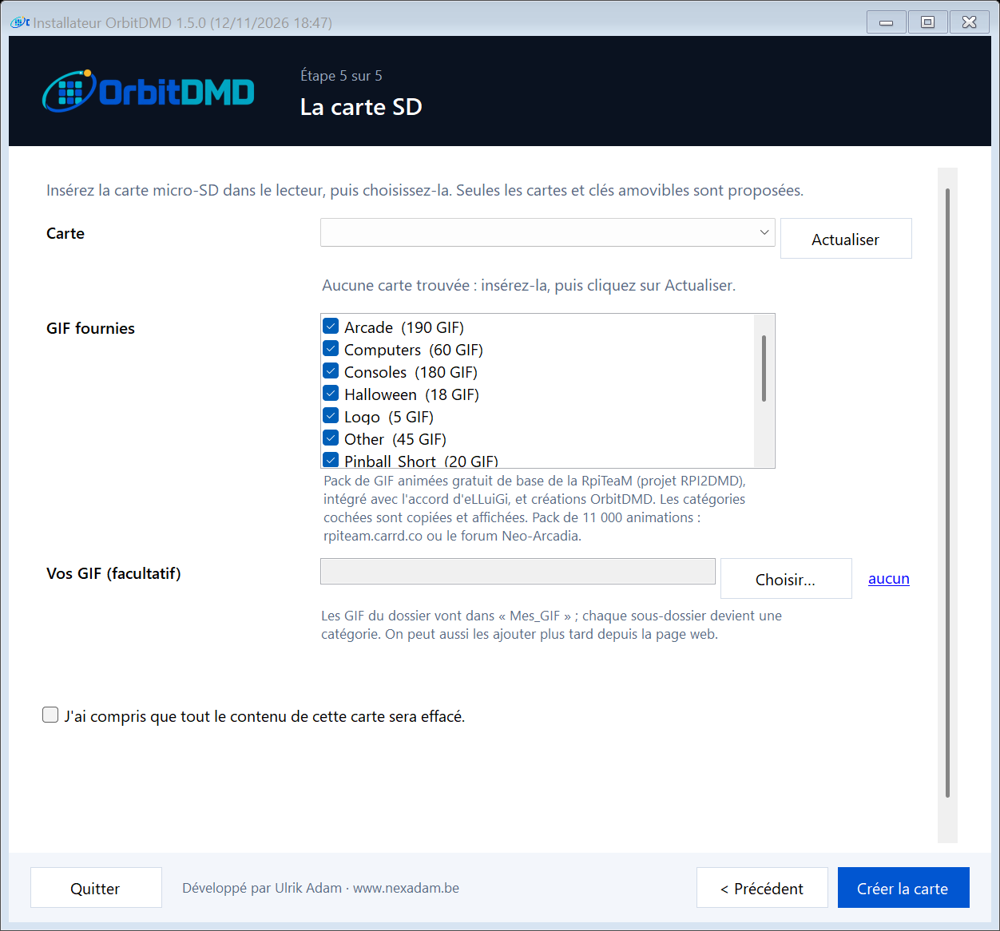

Danach wird alles auf der Webseite eingestellt: GIFs (per Drag & Drop), Uhr, Wetter, WLAN, feste IP-Adresse,
Passwort, Sprache und sogar Firmware-Updates: laden Sie `kernel8.img` aus der neuesten Version unter
[Releases](https://github.com/ulrikadam/OrbitDMD/releases/latest) herunter, dann **System → Neue Firmware**.
Die Sprache der Webseite wählen Sie oben rechts auf jeder Seite, die des Panels unter **Einstellungen → Anzeige**.

## Mitgelieferte Schriften, Hintergründe und GIFs

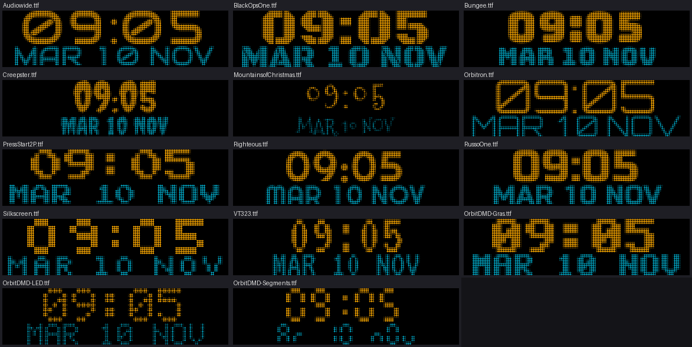

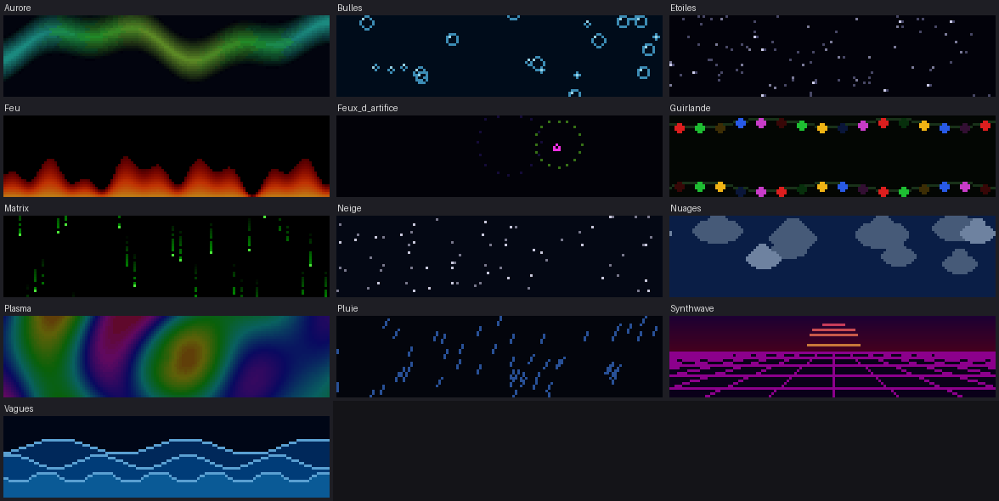

- **Schriften**: Orbitron, Press Start 2P, VT323, Bungee, Audiowide, Black Ops One, Righteous, Russo One,
  Silkscreen, Creepster, Mountains of Christmas (frei, [Google Fonts](https://fonts.google.com/)) und
  3 OrbitDMD-Pixelschriften (LED, Fett, 7 Segmente). Eigene TTF-Schriften fügen Sie auf der Seite Uhr hinzu.
- **Animierte Hintergründe und Muster**: für OrbitDMD erstellt (Sterne, Schnee, Regen, Matrix, Feuer, Polarlicht, Synthwave…).
- **GIFs**: OrbitDMD enthält das **kostenlose Basis-Paket animierter GIFs des RpiTeaM** (Projekt RPI2DMD,
  Pixel-Art von eLLuiGi, RattenJager und anderen), mit Zustimmung von eLLuiGi — danke!
  Wer mehr möchte: **ein Paket mit 11.000 Animationen** gibt es
  [auf Neo-Arcadia](https://www.neo-arcadia.com/forum/viewtopic.php?t=67065) oder auf [rpiteam.carrd.co](https://rpiteam.carrd.co/).
  Die Startbildschirme und ein Teil der Weihnachts-GIFs sind OrbitDMD-Kreationen.
  Videospielfiguren bleiben Eigentum ihrer Rechteinhaber.

## Idee vorschlagen, Problem melden

- 💡 **Eine Idee, eine Verbesserung?** Eröffnen Sie eine [Diskussion](https://github.com/ulrikadam/OrbitDMD/discussions)
  oder einen [Vorschlag](https://github.com/ulrikadam/OrbitDMD/issues/new/choose).
- 🐞 **Ein Problem?** [Melden Sie es](https://github.com/ulrikadam/OrbitDMD/issues/new/choose) mit der Version
  (auf der Übersicht) und, wenn möglich, dem Protokoll der Seite System.
- 🌍 **Eine bessere Übersetzung?** Die Texte liegen in [outils/traductions](outils/traductions): Korrekturen sind willkommen.
- 🛠️ **Mitprogrammieren?** Lesen Sie [CONTRIBUTING.md](CONTRIBUTING.md) und [docs/CONSTRUIRE.en.md](docs/CONSTRUIRE.en.md) (Englisch).

Die Neuerungen jeder Version stehen im [Versionsprotokoll](JOURNAL-DES-VERSIONS.md) (auf Französisch).

## Das Projekt unterstützen

OrbitDMD ist kostenlos. Wenn es Ihnen gefällt, können Sie einen Kaffee spendieren:

## Lizenz

OrbitDMD ist freie Software unter der Lizenz **GNU GPL v3** (siehe [LICENSE](LICENSE)), wie
[Circle](https://github.com/rsta2/circle), auf dem es aufbaut. Lizenzen der übrigen Bestandteile (Schriften,
Raspberry-Pi-Firmware, Wetterdaten): siehe [outils/installateur/carte/LICENCES.txt](outils/installateur/carte/LICENCES.txt).

---

Entwickelt von <b>Ulrik Adam</b> · <a href="https://www.nexadam.be">www.nexadam.be</a>

